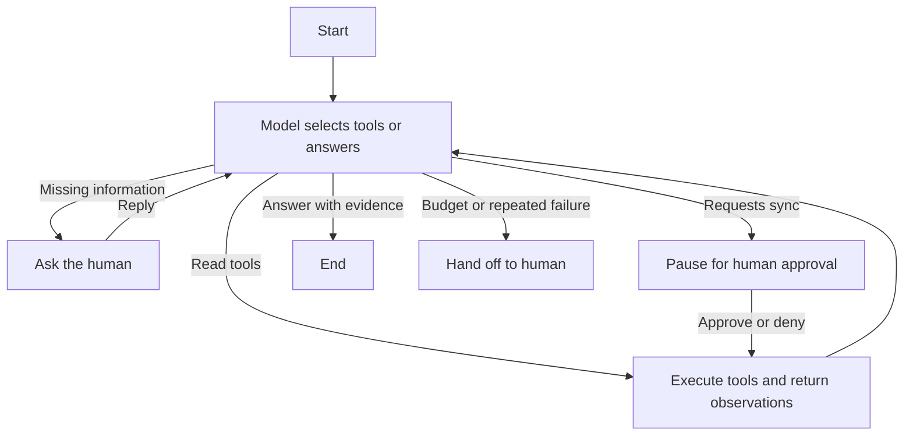

# ReAct agent implementation

The terminal application now runs a single tool-calling ReAct agent on LangGraph.
The model decides which tools to use, observes their results, and can select more
tools before answering. The sequence is not hard-coded to one report pipeline.

## 1. Connect the model and tools

`integrations/model.py` constructs the configured Nebius chat model. `agent/tools.py` registers eight
LangChain tools. `agent/workflow.py` binds those tools with automatic tool choice. The model
receives descriptions and argument schemas, not direct database or API credentials.

## 2. Define investigation state

`AgentState` tracks messages, project/source, reporting cutoff, model/tool/error
counts, successful tool results, answer, and an execution trace. Tool outputs stay
in the message history so the next model decision can use them. This is state
across steps, not a one-shot model call.

Project/source scope is bound by the application. Tool reporting dates cannot
exceed the investigation cutoff. Earlier historical comparison dates are allowed.
Current owners/deadlines/dependencies remain current attributes, not past facts.

## 3. Build the graph



`agent/workflow.py` defines four nodes:

- `model`: call Nebius with tool descriptions and accumulated observations.
- `approval`: interrupt before a requested sync that would write local snapshots.
- `clarification`: pause for missing information and resume with the human reply.
- `tools`: execute selected calls, attach results, record outcomes, return to model.

The model can select multiple tools in a turn; this implementation executes them
sequentially. The trace shows tool names, arguments, outcomes and errors, not hidden
model reasoning. Task data and retrieved memories are treated as evidence, not
instructions, in the agent prompt. This prompt is a mitigation, not a guarantee
against arbitrary hostile documents; our current dataset is synthetic.

## 4. Limit execution and handle errors

Defaults: six model turns, twelve tool attempts, three tool failures. The Nebius
connector has a request timeout. CLI and report requests retain one automatic retry; interactive Q&A uses a separate 60-second timeout with zero automatic retries and a manual Retry button.
Failed tool arguments and unknown tools return observations so the model can
correct them or choose another tool. Malformed JSON selection gets a bounded
repair opportunity. An exact failed call is not executed again. Reaching limits
or receiving no project evidence ends with `needs_human`, not a claimed success.

Source connectors already retry temporary read failures. Permanent permission
failures return actionable errors. A Mem0 failure can be followed by structured
history tools. Unexpected programming errors still surface for debugging.

## 5. Persist execution and gate sync

`agent/runner.py` opens a SQLite LangGraph checkpointer in a separate file:

```dotenv
AGENT_CHECKPOINT_PATH=data/agent_checkpoints.sqlite3
```

Each investigation has a thread ID. A fresh CLI process can inspect the checkpoint
or resume a paused sync. Approval is tied to the pending request. Only actual-day
sync dates are accepted; a pause resumed on another day may require a new request.
The tool reads Notion and writes local snapshots; it does not modify Notion or
upload queued Mem0 observations. Denial returns a tool observation so the agent can
continue with saved data.

The three storage roles are different:

| Storage | Purpose |
| --- | --- |
| Project SQLite database | Exact task records and dated observations |
| Mem0 | Searchable contextual project memories |
| Agent checkpoint SQLite database | Messages, tool results, counters, pending approval |

## Run it

From this project directory:

```sh
source .venv/bin/activate
python -m project_status_agent ask "What is the current sprint status?" --as-of 2026-11-04
python -m project_status_agent ask "Which tasks have been blocked across more than one sprint, and why? Cite evidence." --as-of 2026-11-04
python -m project_status_agent ask "Draft a weekly status report with risk flags." --as-of 2026-11-04
```

These use Nebius credits. Mem0 context tools are remote reads; other analysis tools
read already-synced local data. Use the fixed demo date to reproduce the fixture.
Use `--source csv` for local fixture analysis (Mem0 may have fewer CSV memories).

Output contains `thread_id`, `status`, `answer`, counters, and `tool_trace`. Inspect
without model calls:

```sh
python -m project_status_agent agent-status YOUR_THREAD_ID
```

For an explicit fresh sync, use today's actual date in place of `YYYY-MM-DD`:

```sh
python -m project_status_agent ask "Refresh the project data from Notion, then summarize the sprint." --as-of YYYY-MM-DD
```

If the model requests sync, the response has `status: awaiting_approval` and an
`approval_request`. Review it and select one command:

```sh
python -m project_status_agent agent-resume YOUR_THREAD_ID --decision approve
python -m project_status_agent agent-resume YOUR_THREAD_ID --decision deny
```

Pass the original `--source csv` on status/resume if that was the source. Follow-up questions retain the same thread, messages, and reporting date, with a fresh bounded budget for each new question. Pending clarification/approval must be resolved first. In the UI, clarification uses the chat box and sync approval uses Refresh data / Cancel. A model timeout can be retried from the saved model step without appending the question again or replaying completed tools.

## What is verified

- Offline tests cover the real graph, multiple decision steps, unknown tools,
  corrected arguments, invalid JSON, reporting cutoffs, execution limits,
  approval denial, and SQLite pause/resume after rebuilding the application.
- A live GLM-5.2 investigation independently selected persistent-blocker detection,
  blocker detection, and two Mem0 searches; it returned T-004 and T-008 with dated
  evidence in three model turns and four successful tool calls.

Run tests with `LANGSMITH_TRACING=false python -m unittest discover -s tests -v`. The tests use fake model
responses and temporary databases, not inference credits. On another machine,
install `python -m pip install -e '.[react]'` or the pinned environment in
`requirements-tools.lock`.

## Report workflow and remaining scope

The separate reports/workflow.py pipeline implements structured report validation, versioned review, stale-approval guards, and local approved saving. The Streamlit interface supports Q&A, reports, review, and downloads. General Q&A narrative claims remain model-generated and are not independently validated. Approved-summary publication to Mem0 is not implemented; source observations are published explicitly through the CLI. Sync approval does not approve or publish a report.

Reference: [LangGraph Graph API quickstart](https://docs.langchain.com/oss/python/langgraph/quickstart).

## Follow-up evidence reuse

Follow-ups retain prior tool messages and a fixed project/source/reporting cutoff. The runner counts successful read-tool observations only when their JSON envelope matches that exact scope and cutoff. The model may answer from relevant matching observations without a new tool call. New model/tool/error budgets still reset each turn. Failed tool outputs, sync/clarification results, human messages, and previous model answers do not qualify as evidence. A fresh conversation with no retrieved evidence still hands off rather than accepting an unsupported model answer. New facts outside the available observations require a relevant tool call or clarification.

reused_evidence_count is included in backend results and traces for verification; the end-user chat remains free of diagnostics. Existing saved conversations require no migration because original tool messages are already checkpointed. This guard establishes the availability of matching evidence, not independent verification of every generated narrative claim.

## Recover a missing tool selection

For a fresh question without valid retrieved/reused evidence, an answer without a tool call is discarded. The graph adds one instruction to retrieve relevant records and allows one more model decision within the existing six-call budget. The model still chooses the tool dynamically. If it again returns an unsupported answer, the workflow stops with needs_human. No unlimited retry loop or provider/network retry was introduced. Follow-ups with valid scoped evidence skip this recovery. evidence_retries and an evidence_required trace event identify the recovery path in backend records.

The recovery counter resets for a new user question, but is retained during a timeout retry or tool-error recovery within that turn. This prevents a failed tool from granting additional missing-selection retries. Human sync approval, project/source/cutoff checks, tool budgets, and the UI timeout policy remain in force. Unsupported answer text is not saved as an assistant message or displayed to the user.
